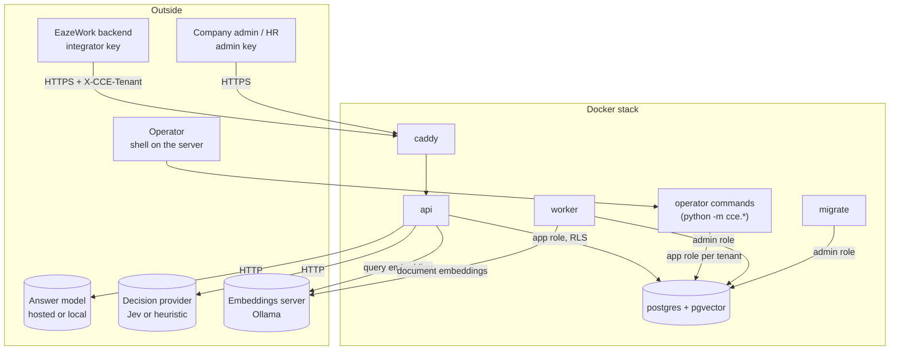
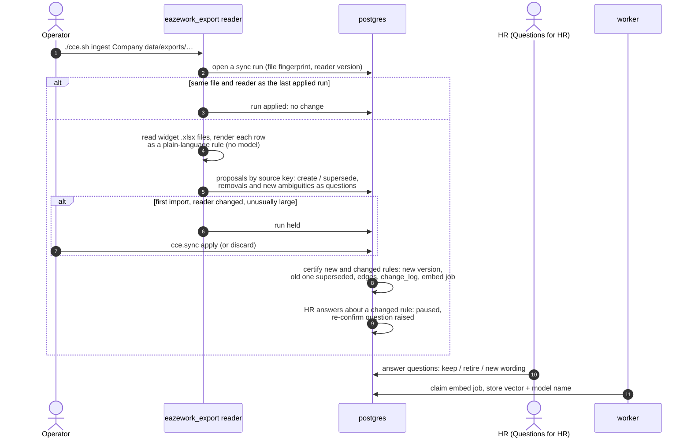
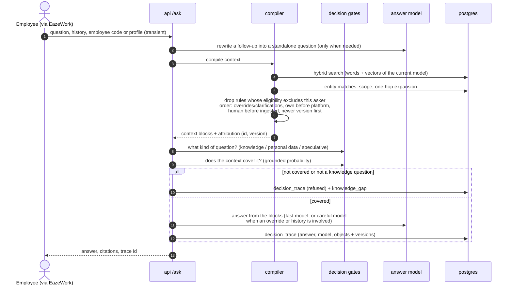

# 01. Processes and data flow

## What runs

One image, several entrypoints (ADR-0001). All state lives in Postgres; the processes keep none.

| Process | Started by | Talks to | Does |
|---|---|---|---|
| `postgres` (+pgvector) | compose | — | All data. Row-level security enforces tenancy (ADR-0010) |
| `migrate` | compose, on every start | postgres (admin role) | Applies Alembic migrations, then exits (ADR-0006) |
| `api` | compose | postgres (app role, RLS), answer model, decision provider, embeddings provider | HTTP API, `/ask`, `/demo` chat UI |
| `worker` | compose | postgres (admin role), embeddings provider | Runs queued jobs: `embed`, and `dependents_fanout` (after a shared rule changes, flag companies' own answers about it) |
| Operator commands | `docker compose run --rm api python -m cce.<x>` | postgres directly | Readers (connectors), sync runs, certify, questions, tenants, packs, corrections, embed backfill |
| `caddy` | prod compose | api | TLS and reverse proxy (ADR-0004) |
| Outside the stack | — | — | Answer model (hosted or Ollama/vLLM), Jev decision provider (optional), embeddings server (Ollama) |

Operator commands do **not** go through the HTTP API. They open their own database session,
but they call the same functions as the API (`store.certify_proposal`, `store.create_object`),
so the same checks apply and the same `change_log` rows are written.

## How processes hand work to each other

There is no message broker. Processes communicate through Postgres:

| From → to | Mechanism | Written in the same transaction as the data? |
|---|---|---|
| api / commands → worker | A row in `jobs`; the worker claims it with `SELECT … FOR UPDATE SKIP LOCKED` (ADR-0002) | **Yes.** `create_object` inserts the object and its `embed` job together, so a job can never refer to a row that was rolled back |
| any writer → audit | A row in `change_log` (append-only) | Yes |
| reader → certifier | A row in `proposals` with `status = pending` | Yes |
| certifier → answering | `knowledge_objects.status = active`; the next `/ask` sees it | Yes, nothing is cached except the platform tenant list (30 s) |
| `/ask` → admin | A row in `decision_traces`, and in `knowledge_gaps` when refused | Yes |

The worker polls every 2 seconds when idle. A failed job is retried after 30 seconds, up to 3
attempts, then marked `failed` with the error kept.

## Flow 1: a configuration export becomes knowledge

Each import is a **sync run** (ADR-0022, [04 Change paths](04-change-paths.md) B).

Tables written: `source_snapshots`, `proposals`, `knowledge_objects`, `dependency_edges`, `change_log`, `jobs`.
The employee profile report is never read by this reader (ADR-0017).

## Flow 2: an employee asks a question

The asker's profile is used to filter rules and is **not stored** and **not sent to the model**
(ADR-0018).

## Flow 3: a person changes knowledge

| Who | How | Result |
|---|---|---|
| HR answers a question for HR | `POST /questions/{id}/answer`, `make answer` | A certified `Clarification` that `interprets` the rules the question was about |
| Admin corrects an answer: rule wrong | `POST /traces/{id}/correction` cause `rule` | A `Clarification` proposal, certified at once unless `CCE_CORRECTIONS_REQUIRE_APPROVAL=true` |
| Admin corrects an answer: answer misread | same, cause `misread` | Knowledge unchanged; a test case for model and prompt changes |
| Admin corrects an answer: HR data wrong | same, cause `data` | Knowledge unchanged; an item in Questions for HR; the fix belongs in EazeWork |
| Anyone with a key | `POST /proposals` then `/certify` | Any create / supersede / deprecate, risk auto-scored |

## Flow 4: EazeWork help-center content

The same as flow 1, with the `documents` reader and the **platform tenant** (ADR-0015). Source
keys are `helpcenter:<slug>[#section]`; unchanged articles (same content hash) are skipped.
Help-center runs are always held for a person; a folder is a full release, so missing
articles become questions. When a shared article changes, the worker flags companies' own
overrides of it in their Questions for HR.
Every company reads platform objects; no company can change them, only interpret them with a
`TenantOverride`.
