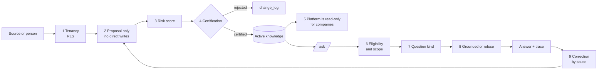

# 02. Governance

Governance here means: **who or what may change what the system believes, and what checks an
answer passes before anyone sees it.** Each gate below names where it is enforced. "Database"
means Postgres refuses the action even if application code is wrong.

## The gates, in the order data meets them

| # | Gate | What it stops | Enforced in | Status |
|---|---|---|---|---|
| 1 | **Tenancy** | One company reading or writing another's data | Database: RLS on every tenant table, `app.tenant_id` set per transaction (ADR-0010) | Implemented |
| 2 | **Proposal only** | Readers, agents or people writing knowledge directly | Code: `store.certify_proposal` creates objects from proposals; edges are declared on proposals and created at certification. Exception: `POST /objects` (admin keys only) | Implemented |
| 3 | **Risk score** | Treating a statutory change like a typo fix | Code: `decide.score_risk` (heuristic, or Jev when configured), using blast radius (dependents, answers that used the target) (ADR-0014) | Implemented for `POST /proposals`. Readers set `risk=med` themselves |
| 4 | **Certification** | Unreviewed content becoming knowledge | Code: `/proposals/{id}/certify` (admin keys), `python -m cce.certify approve` (bulk, least confident first, `--dry-run`), and sync runs (`cce.sync`): company config changes apply on their own unless held; help-center runs always wait for a person. Questions for HR, re-confirmations and removals are never bulk-approved | Implemented |
| 5 | **Platform knowledge is read-only for companies** | A company changing EazeWork's shared content for everyone | Database: split RLS (read own + platform, write own only). Code: supersede/deprecate of a platform object is refused with a pointer to `TenantOverride` (ADR-0015) | Implemented |
| 6 | **Eligibility and scope** | Answering with a rule meant for other employees | Code: compiler evaluates EazeWork eligibility expressions against the transient profile; scope excludes other locations or grades (ADR-0018) | Implemented |
| 7 | **Question kind** | Answering "what is my balance?" or "will the policy change?" from policy text | Code: `decide.classify_question` | Implemented |
| 8 | **Grounded or refuse** | Answering when the context does not cover the question | Code: `decide.grounded`, threshold `CCE_GROUNDED_REFUSE_THRESHOLD` (0.35). Refusals log a knowledge gap | Implemented |
| 9 | **Correction by cause** | Patching knowledge to hide a model mistake, or papering over wrong HR data | Code: `POST /traces/{id}/correction` with cause `rule`, `misread` or `data` (ADR-0020) | Implemented. Second-admin approval is off by default |

## People and roles (ADR-0024)

| Role | Where | Can |
|---|---|---|
| EazeWork admin | platform tenant | Companies' first HR admin, staff, account-manager assignments, EazeWork default settings and per-company values and locks, help-center releases |
| Account manager | assigned companies (`X-CCE-Tenant`) | HR admin work in the company; not its people, not its access settings, not the employee question log without a grant |
| HR admin | own company | Everything for the company, incl. people, settings, grants, switching account-manager access off |
| Employee | own company | Ask; read own answers |
| Integrator key | EazeWork's backend, any company | Ask, propose, read knowledge |
| Old shared `admin` key | own tenant | As HR admin (company) or EazeWork admin (platform) |
| Operator token / command line | the server | Create tenants, first EazeWork admin, everything |

Permissions are resolved per request (`cce.access.resolve`) from the role, the tenant acted in,
the assignment, the company's `access.account_managers` setting and active grants. Every change
records the person (`change_log.actor_id`); `GET /activity` shows a company everything done in it,
including by EazeWork and every read under a grant.

## Audit trail

Every certification, rejection, supersession, deprecation, edge creation and knowledge gap
writes a `change_log` row. Nothing updates or deletes `change_log` rows. Together with
`decision_traces` (object ids and versions per answer) this answers:

- "Why did the bot say this on 3 November?": the trace lists the exact object versions.
- "Who approved that rule?": `proposals.decided_by`, `decided_at`.
- "What did this rule say before?": the `supersedes` chain.

## Known gaps

Tracked here so they stay visible. Fixed items stay listed for one release with how.

| Gap | Risk | Status |
|---|---|---|
| ~~When a rule was superseded, incoming `interprets` edges moved to the new version without review~~ | An HR answer about "12 days" kept ranking first after config said 15 | **Fixed** (ADR-0022, migration 0009): edges are pinned to a version; the HR answer is paused and HR is asked to re-confirm (`CCE_STALE_INTERPRETATIONS`) |
| ~~Rows that disappear from an export were not deprecated~~ | A closed leave type kept being answered | **Fixed**: they become removal questions for HR |
| ~~No record of an import as a unit~~ | A bad export could only be undone object by object | **Fixed**: sync runs, held / applied / discarded / rolled back (`cce.sync`) |
| ~~Integrator key could certify on a company's behalf~~ | EazeWork's backend key could change any company's knowledge | **Fixed**: certify, reject, answer questions, `POST /objects`, entities need an admin key |
| ~~Traces lacked build and prompt~~ | Couldn't tell which code produced an old answer | **Fixed**: `build_sha`, `prompt_hash` on every trace |
| ~~Image published without waiting for CI~~ | A broken build could be pulled | **Fixed**: `image.yml` runs after CI succeeds |
| No separation between proposer and certifier among admins | One admin can propose and approve their own change | Later: certifier roles per domain/type (Design Review G9). Every decision now names the person |
| People sign in with personal keys | Keys can be shared or leaked | Next: EazeWork's signed per-user token (design/09 §1.5) |
| `POST /objects` writes a knowledge object without a proposal | An admin can bypass review (used by the walking skeleton and seeding) | Admin keys only; replace with propose + certify when the seed path moves |
| `CCE_CORRECTIONS_REQUIRE_APPROVAL` defaults to false in code | Corrections become knowledge immediately | `true` in the partner template; turn on before a real company uses it |
| Backups built but not yet scheduled on our own server | Loss of all certified knowledge | ADR-0007 implemented: choose the off-site target and add the two cron lines (CONFIGURATION.md §11) |
