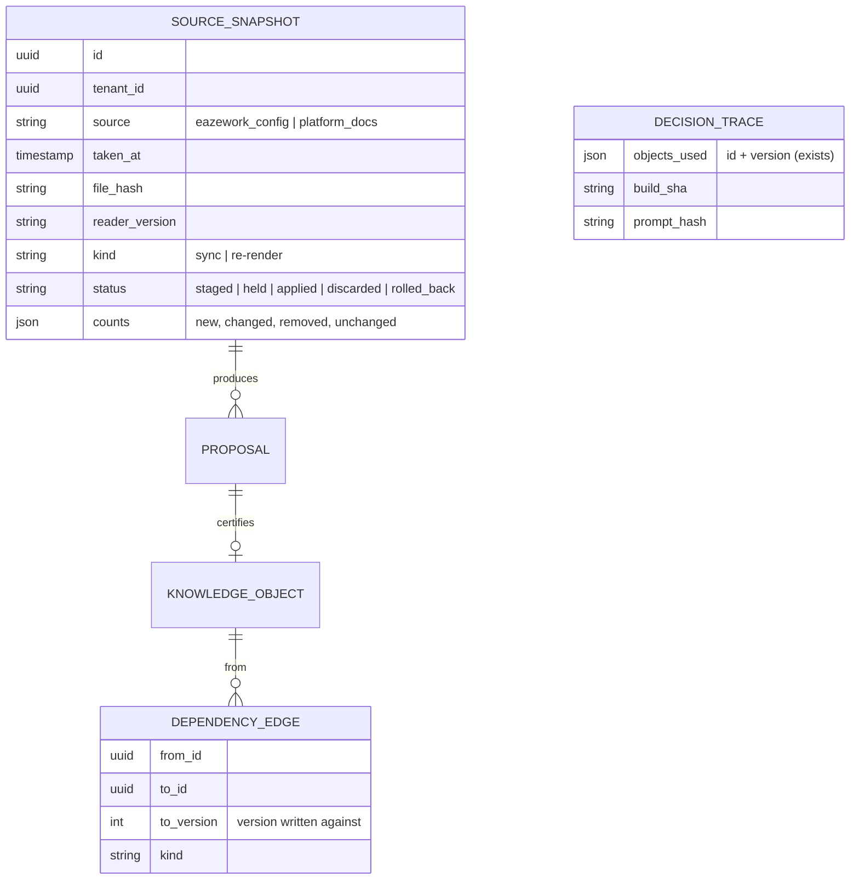

# 03. Versioning

An answer depends on many things that change at different speeds: the company's configuration,
EazeWork's help center, our reading code, prompts, models, embeddings and the schema. To explain
an old answer or undo a bad change, each of these needs its own version. This page lists them.

## Inventory

| What | Changes when | How it is versioned today | Recorded on the answer? | Status |
|---|---|---|---|---|
| **Knowledge object** | A proposal is certified | `version` (1, 2, 3…), `supersedes` link to the previous row, `status` active / superseded / deprecated / suspended (an HR answer paused until re-confirmed); old rows are kept | Yes: id + version in `decision_traces.objects_used` | Implemented |
| **Valid time** of a rule | The rule's own effective dates | `valid_from` / `valid_to`; on supersede the old window closes the day before the new one opens. `/ask` takes `as_of` to answer for a past date | Indirectly (versions used) | Implemented |
| **Dependency edges** | Certification | `to_version`: the version of the target the edge was written against. On supersede, HR answers (`interprets` from human-authored objects) stay pinned and are paused or flagged; other edges move to the new version | No | Implemented ([ADR-0022](../adr/0022-sync-runs-and-version-pinned-interpretations.md), migration 0009) |
| **Proposal** | Created, then certified or rejected once | Immutable after decision; `decided_by`, `decided_at` | No | Implemented |
| **Embeddings** | Model change | `embedding_model` stored per row; vectors from different models are never compared; switching models is an explicit backfill (ADR-0009, ADR-0016) | Returned by `/ask`, not stored on the trace | Implemented |
| **Database schema** | Migration | Alembic revisions `0001`…`0009`, applied by the one-shot `migrate` service (ADR-0006) | No (implied by build) | Implemented |
| **Code and image** | Merge to main, after CI passes | Image tagged with the git SHA CI tested; `/healthz` reports `sha` and, for partner builds, `build` id (ADR-0005, ADR-0021) | Yes: `decision_traces.build_sha` | Implemented |
| **Prompts** | Code or settings change | Constants in `cce.llm` (+ the configured system suffix) | Yes: `decision_traces.prompt_hash` (12 hex) | Implemented |
| **Answer model** | Settings change | Provider and model name | Yes: `provider`, `model`, and `route` (fast / careful) | Implemented |
| **Reader (connector) code** | Code change | `reader_version` = fingerprint of the reader's modules, recorded on each sync run; a weekly sync refuses a changed reader until a re-render of the previous export | Via the run that produced each object | Implemented |
| **Source snapshot** (one export) | Each import | `source_snapshots`: file fingerprint, reader version, label, status, counts; `proposals.snapshot_id` | Via the run that produced each object | Implemented |
| **Platform release** (help center) | Each import into the platform tenant | A sync run of source `helpcenter`, named by its folder (e.g. `help-center-2026.11`); always held for a person | Via the run | Implemented (release = run label) |
| **Domain pack** | Pack YAML edited | Git; installing is "diff + certify", so pack objects get normal object versions (ADR-0012) | Via object versions | Implemented |
| **Eval and question sets** | Cases added or fixed | Git; file names carry a version (`golden-hrms-v1`, `widget-v1`) | n/a | Implemented |
| **Configuration (deploy)** | `.env` edited | Not versioned; deploy facts only (ADR-0008) | No | Accepted |

## Two clocks

Knowledge has two independent time axes (Design Review G4):

- **Valid time**: when the rule is in force in the company (`valid_from` / `valid_to`).
- **Transaction time**: when we learned it (`created_at`, `change_log.at`).

"What would the bot have said on 1 June about the April policy?" needs both. Today `as_of`
selects by valid time; transaction time comes from the change log. A weekly sync means
transaction time can lag valid time by up to 7 days; see [04 Change paths](04-change-paths.md).

## The additions from ADR-0022 in one picture

