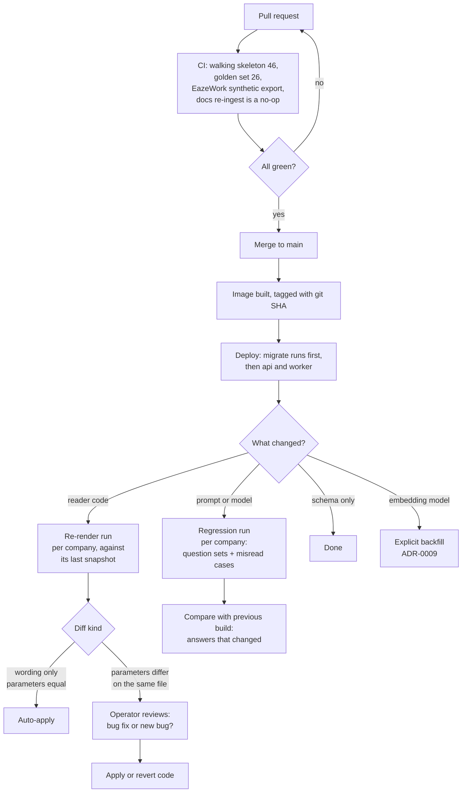
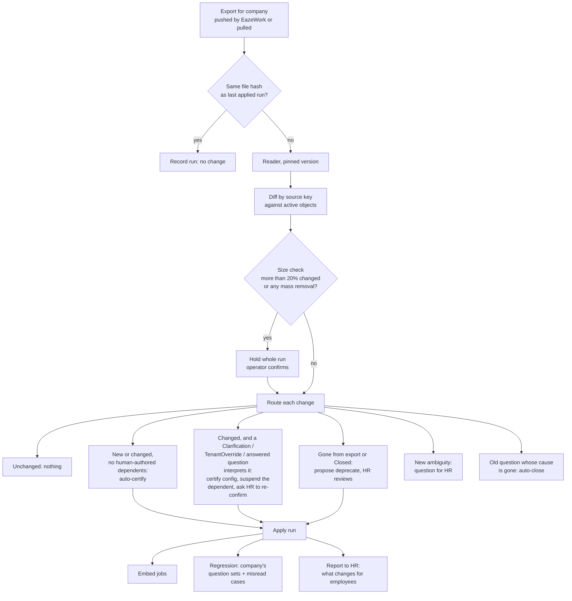
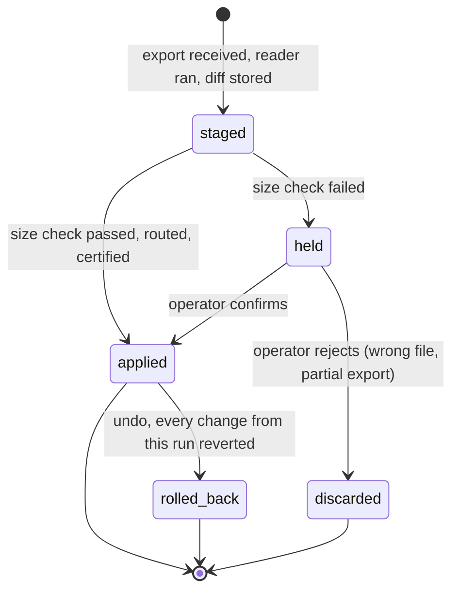
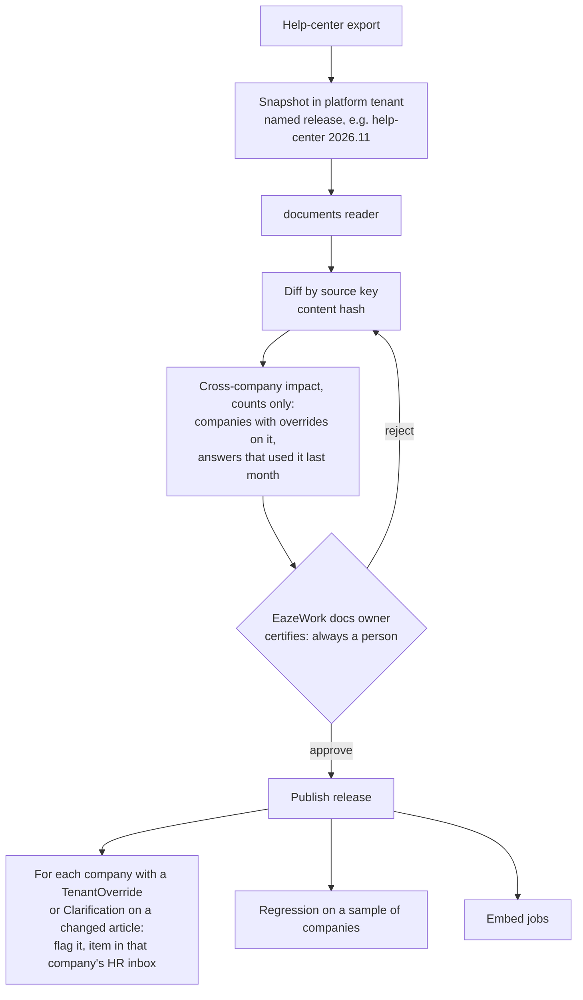

# 04. Change paths

Four kinds of change reach CCE. They differ in who starts them, how often they happen, how
far they reach, and what can go wrong. The rest of this page takes each one in turn.

| | **A. Code change** | **B. Company configuration sync** | **C. EazeWork platform change** | **D. Human change** |
|---|---|---|---|---|
| Examples | Reader fix, new prompt, model switch, migration | HR raises Casual Leave from 12 to 15 days; a shift is added; a leave type is closed | Help-center article rewritten; new module documented | HR answers a question; admin corrects an answer |
| Started by | Us (a merged PR) | The company's EazeWork setup, picked up by a sync | EazeWork product/docs team | HR or a company admin |
| Cadence | Any time | **Weekly** (proposed), plus on demand | **Monthly** (proposed), ideally tied to EazeWork releases | Any time |
| Reaches | Every company, through every answer | One company | **Every company** (platform tenant) | One company |
| Is the source "true" already? | n/a | Yes: EazeWork enforces it, HR already set it | Yes for EazeWork, but may not match a company's own rules | Yes, by the person's authority |
| Main risk | Same input, different knowledge, looks like a real change | Upstream change contradicts something a human told us | One change silently alters answers in many companies | A person's statement goes stale when the rule changes |
| Unit of review | PR + regression results | Sync run | Platform release | Single proposal |
| Undo | Revert the image; undo its re-render run | Roll back the sync run | Roll back the release | Supersede or deprecate |

## The one principle behind all four

**Separate "the world changed" from "our reading of the world changed".** A config sync must
contain only changes in the company's configuration. A code release must not change knowledge
unless a deliberate re-render run is applied. When the two are mixed, a reworded template looks
like HR rewrote half their policies, and a real change hides inside a code release.

---

## A. Code change

Implemented (ADR-0022, migration 0009):

- The image is published only after CI passes (`image.yml` runs on the CI workflow's success).
- Each sync run records `reader_version`, a fingerprint of the reader's code. A weekly sync with a
  different reader than the last applied run is refused; the operator re-reads the *previous*
  export with `--re-render`, so the source cannot have changed. If that export is gone,
  `--allow-reader-change` runs the sync but holds the whole run for review.
- In a re-render, a diff where the structured `parameters` (and eligibility) are equal and only
  the text differs applies at once. A diff where they differ is held: the code now reads the
  configuration differently.
- `decision_traces` records `build_sha` and `prompt_hash`.

Still manual: per-company regression runs after a prompt or model change (`make ask-set`,
`make baseline`).

---

## B. Company configuration sync (weekly)

**Why config can auto-certify.** HR has already approved a rule by setting it in EazeWork,
and EazeWork enforces it. Certification of a config diff checks two other things: that we read
it correctly (covered by the reader's tests and the re-render rule above) and that it does not
contradict something a person told us (covered by the routing).

**The stale-clarification rule.** When a rule changes and a human-authored object interprets
it, the human object is **suspended from answers** until HR re-confirms it, and the new config
answers in the meantime. Rationale: the clarification was written against the old rule. If it
said "12 days" and config now says 15, keeping it ranked first produces a confident wrong answer
with human provenance, which is the worst case. `CCE_STALE_INTERPRETATIONS=flag` keeps it in use
while HR is asked instead; `follow` restores the old behaviour (edge moves silently).

HR answers the re-confirmation in Questions for HR: **keep** (back in use, now attached to the
new version), **retire**, or write new wording (a new version of the answer).

**Removals.** A row that disappears from the export, or a leave type that becomes Closed, becomes
a removal question for HR (keep / retire); retiring certifies the deprecation. Nothing is
deleted. A removal is riskier than an addition: a partial export would otherwise retire real
rules, and more than `CCE_SYNC_HOLD_REMOVALS` removals hold the whole run.

**Cadence.** Weekly is the default, set per company. HR can trigger a sync after changing a
policy ("sync now"), so the weekly lag is a ceiling, not the normal case. If the export carries
effective or last-modified dates, they set `valid_from`; otherwise the snapshot time does.
*Not built yet:* the schedule itself. Today an operator (or a cron calling `./cce.sh ingest`)
starts each sync; how exports arrive is one of the questions for EazeWork.

**Report to HR.** After a run, replay the company's recent questions against the new knowledge
and list the answers that would change. HR reviews what employees will see, not object diffs.
Design doc 04 already describes this as the "regulatory-response" report kind.

### Sync run lifecycle

Rolling back a run restores the previous version of every object it changed, re-activates
objects it deprecated, and un-suspends dependents it suspended. Answers given in between keep
their traces; they can be listed by run.

---

## C. EazeWork platform change (monthly)

Differences from a company sync:

- **Never auto-certified.** One change reaches every company, so a person at EazeWork approves
  every platform release. The certifier is on EazeWork's product side, not a company's HR.
- **Impact in counts only.** The impact preview may say "7 companies override this article"
  but never shows one company's content to another (Design Review G6, cross-tenant leakage).
- **Fan-out to companies.** A company's override of a changed article goes into that
  company's own Questions for HR. The override keeps working but is marked for review: unlike
  config, help-center text is guidance, so suspending a company's own rule would be wrong.
- **Timing.** Help-center text describes product behaviour. A monthly calendar sync can drift
  from EazeWork's release schedule; tying the platform sync to EazeWork releases avoids answers
  that describe a version of the product not yet (or no longer) deployed.

---

## D. Human change

Already implemented (ADR-0017, ADR-0020). What this page adds is how human changes interact
with A–C: every Clarification and TenantOverride records **which version** of the rule it
interprets (ADR-0022), so B and C can tell when it has gone stale.

---

## Questions to settle with EazeWork

1. Do they push exports to us, or do we pull? Can HR trigger a sync after a policy change?
2. Does the configuration export carry last-modified or effective dates?
3. Are all companies on the same product version, so one help center fits all, or do modules
   or versions differ by company?
4. Who at EazeWork certifies platform releases?
5. May we keep raw exports? They contain the employee mapping (personal data). Default
   proposal: keep the file hash and the parsed result; keep raw files for 30 days.
6. Does EazeWork already run an event bus (Kafka or similar) that publishes configuration
   changes? See [06 Events and Kafka](06-events-and-kafka.md).
