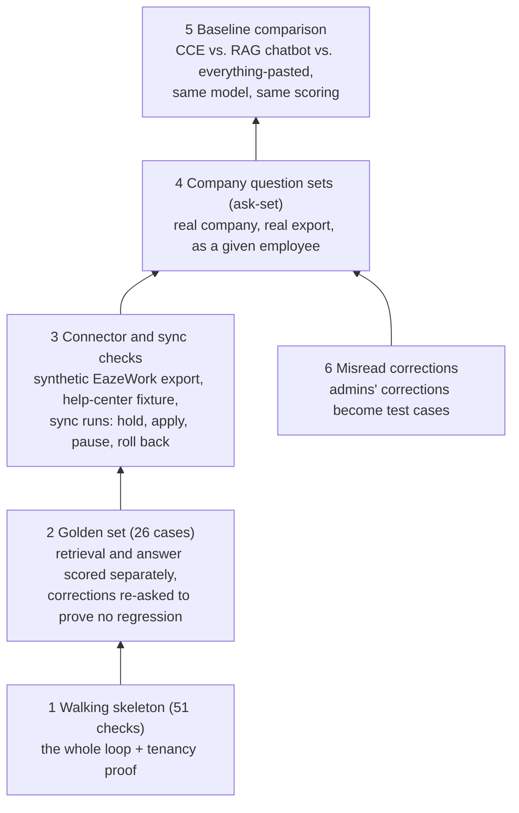

# 05. Testing

CCE is tested end to end against a real stack (Postgres, API, worker) rather than with unit
tests. The reason is that the claims that matter are cross-cutting: "a correction never
regresses", "company A can't see company B", "re-importing an unchanged export changes
nothing". Those only hold if every layer cooperates, so the tests drive the system the way a
client does.

## Layers

| # | Layer | Command | Runs in CI | Answer model | Catches |
|---|---|---|---|---|---|
| 1 | Walking skeleton | `make skeleton` | Yes | `echo` (offline) | Broken loop: ask, propose, impact, certify, re-ask, trace attribution (incl. build and prompt), RLS isolation between two tenants, integrator key can't certify or write |
| 2 | Golden set | `make eval` | Yes (25/26 lexical, 1 expected failure) | `echo` in CI; real model on a laptop | Retrieval regressions; answers from the model's own knowledge instead of the context (flagged `ANSWERED-FROM-PRIORS`); a certified correction regressing across repeated runs |
| 3a | EazeWork connector | `scripts/check_eazework.py` | Yes | none | Reader regressions on a synthetic export in EazeWork's layout (no customer data in the repo); eligibility; questions for HR; answering a question certifies a Clarification |
| 3c | Sync runs | `scripts/check_sync.py` (`make check-sync`) | Yes | none | First import held; same export is "no change"; a rule change pauses the HR answer about it and asks HR; removals become questions; fixed ambiguities are withdrawn; rollback restores everything; keep / retire; reader change refused, re-render held when a rule is read differently; partial export held and discarded; a shared rule change flags a company's own rule (worker fan-out); an answer about two rules; partial exports; rollback after a no-change run; discarding a partly certified run; a run rejected item by item |
| 3d | Backup and restore | `deploy/backup.sh dump` + `verify` | Yes (and the partner-image gate) | none | A dump that doesn't restore, or whose row counts don't match |
| 3b | Documents connector | CI step "Document connector" | Yes | none | Help-center ingest; re-ingesting the same files proposes nothing (`0 new, 0 supersede`) |
| 4 | Company question sets | `make ask-set KEY=… SET=…` | No (needs a real export) | Real | Wrong answers on a real company, per employee; writes a Q&A report EazeWork can check |
| 5 | Baseline | `make baseline KEY=… T=…` | No | Real | Whether CCE beats a plain chatbot with the same documents (Phase 1 exit gate) |
| 6 | Misread corrections | `make corrections T=…` then `make ask-set SET=<export>` | No | Real | Model or prompt changes that re-introduce a known misreading |

CI (`.github/workflows/ci.yml`) never calls a hosted model, so it runs on any fork without
keys. Answer quality with real models is measured on a laptop or server and recorded in
`docs/STATUS.md` and `eval-results/`.

## What each change path must run

| Change ([04](04-change-paths.md)) | Must pass before it reaches companies |
|---|---|
| A. Code | CI layers 1–3 (the image is published only after CI passes). If the reader changed: re-render diff reviewed. If prompts or model changed: layers 4 and 6 for every pilot company, compared with the previous build |
| B. Company config sync | After applying: layer 4 and 6 for that company; "what changes for employees" report to HR |
| C. Platform release | Layer 4 on a sample of companies |
| D. Human change | The correction itself becomes a layer-6 case (misread) or is covered by its Clarification |

## Gaps

| Gap | Effect | Proposal |
|---|---|---|
| No unit tests | Small functions (eligibility parser, late-coming rule rendering) are tested only through end-to-end checks; failures are slower to locate | Add `pytest` for `cce.eligibility` and the reader's rendering functions first: pure functions, many edge cases |
| Golden set runs with `echo` in CI | CI proves retrieval, not answer wording | Keep; real-model runs stay manual because they cost money and vary |
| Layers 4–6 are manual | Model or prompt changes can ship without a company-level regression run | Next: run a company's question sets after each applied sync and re-render (traces now carry `build_sha` / `prompt_hash` to compare builds) |
