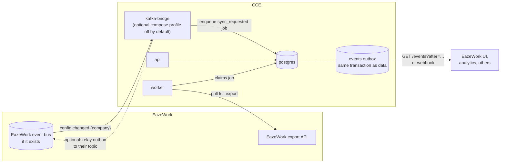

# 06. Events and Kafka

Should CCE introduce Kafka? This page looks at each place an event log could go, what it
would buy and what it would cost. The decision is recorded in
[ADR-0023](../adr/0023-no-kafka-inside-cce-events-at-the-boundary.md).

## What Kafka is good at

A durable, ordered, replayable log that **many independent consumers** read at their own pace,
at **high volume**, across **separately deployed services**. The value grows with the number
of producers and consumers that should not know about each other.

## What CCE looks like

- One application image with three entrypoints (ADR-0001); one database.
- Volumes are small: a weekly export per company, a monthly help-center release, a few
  thousand questions a day at pilot scale, one `embed` job per new object.
- Work is handed over through Postgres, in the **same transaction** as the data it refers to
  (ADR-0002). A proposal and its job, an object and its embed job, commit together or not at all.
- Tenancy and the ability to erase personal data both rely on Postgres (RLS, deletes).
- Partners run the stack themselves on a 4–8 GB server ([deploy handbook](../../deploy/CONFIGURATION.md)).

## Candidate uses, one by one

| Candidate | Would Kafka help? | Cost if we used it | Better fit now |
|---|---|---|---|
| **1. EazeWork tells us a company's configuration changed** | **Yes, if EazeWork already runs Kafka.** It removes the weekly lag: a change can trigger a sync within minutes | Event schema agreement; events can be missed or arrive out of order, so a full snapshot is still needed to be sure | Treat the event as a **trigger** ("company X changed, sync now"), not as the data. The sync still reads a full export, so a missed or duplicated event costs nothing |
| **2. Internal jobs** (embed, re-render, regression, reports) | No | Loses the same-transaction guarantee: writing the row and publishing the message become two writes that can disagree, which needs an outbox anyway | Postgres queue (today) + `LISTEN/NOTIFY` so the worker wakes at once instead of polling |
| **3. Fan-out of a platform release to every company** | No | A topic per company or a consumer per company for tens to hundreds of companies | One job per affected company in the existing queue |
| **4. Telling other systems what happened** (a question for HR was raised, a rule changed, a sync was applied) | Somewhat: this is the classic event-log use | A broker to run and secure; tenant isolation and erasure must be rebuilt outside Postgres; personal data in topics is hard to delete (DPDP) | An **outbox**: an ordered `events` table written in the same transaction, exposed as `GET /events?after=<id>` and optional webhooks. `change_log` is already nearly this |
| **5. Answer analytics** (traces to a warehouse) | Not at this volume | As above | Nightly export or read replica |

## Recommendation

**No Kafka inside CCE. Events at the boundary, through an outbox.**

What this gives:

- **Near-real-time sync** where EazeWork can send a signal, without making the signal the
  source of truth. The weekly sync stays as a safety net.
- **Other systems can follow CCE** (new question for HR, sync applied, rule changed) through
  a feed that respects tenancy because it is served by the API.
- **Nothing new to run** for partners who don't use Kafka: the bridge is a compose profile
  (ADR-0003), like `local-llm` and `observability`.
- If EazeWork does run Kafka, the bridge connects the two sides, and Kafka stays with the
  team that already operates it.

## When to revisit

Introduce a broker inside CCE when one of these becomes true:

1. Several separately deployed services need to consume CCE's events independently, and
   the outbox feed is getting complicated to serve.
2. Sustained job volume reaches thousands per minute, where a Postgres queue starts to strain.
3. Consumers need to replay long event history on their own schedule.
4. EazeWork requires it as their integration standard.

If that happens, a single-binary Kafka-compatible broker (Redpanda) is the lighter first step
for a small deployment. The outbox stays: it is how a broker gets fed without losing
same-transaction guarantees.
