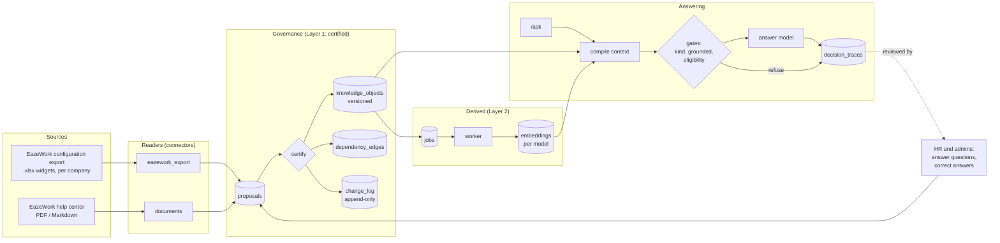

# How CCE works

This folder describes the system **as it runs today**, plus the changes that have been
proposed but not built yet. Each proposed change is marked **Proposed** and links to its ADR.
It is the place to answer "what happens when…" without reading the code.

The design docs (`../design/`) explain *why* the system looks like this. The ADRs (`../adr/`)
record each decision. These pages show the result: processes, data, gates, versions and tests.

| Page | Answers |
|---|---|
| [01 Processes and data flow](01-processes-and-data-flow.md) | What runs, how data moves between processes, which tables each step reads and writes |
| [02 Governance](02-governance.md) | Every gate that stands between a source and an answer, who can pass it, and where it is enforced |
| [03 Versioning](03-versioning.md) | Everything that has a version (knowledge, embeddings, schema, code, packs, eval sets) and what does not yet |
| [04 Change paths](04-change-paths.md) | What happens on a code change, a company configuration sync, and an EazeWork (platform) change, today and as proposed |
| [05 Testing](05-testing.md) | The test layers, what each catches, what runs in CI and what runs by hand |
| [06 Events and Kafka](06-events-and-kafka.md) | Where an event log would and would not help, and the recommendation |

## The system on one page

Three rules hold everywhere:

1. **Nothing becomes knowledge without certification.** Readers, people and agents all
   *propose*; `store.certify_proposal` is the only code path that writes a knowledge object.
2. **Answers cite certified objects only.** Embeddings and other derived data help find
   knowledge but never count as knowledge (ADR-0013).
3. **Every answer records what it used.** A decision trace stores the object ids *and
   versions* that went into the prompt, so any answer can be explained later.

## Where documentation lives

| Kind | Folder | Changes when |
|---|---|---|
| Why: problem, design reasoning | `docs/design/` | A design is materially revised (bump the version header) |
| Decisions | `docs/adr/` | A decision is made. Never edited after acceptance; superseded by a new ADR |
| How it works now | `docs/architecture/` (this folder) | Any change to processes, gates, versioned things or tests. **Update in the same PR as the code.** |
| How to run it | `deploy/CONFIGURATION.md`, `docs/DEPLOY-AND-DATA.md` | Any change to commands, settings or deploy steps |
| Where we are | `docs/STATUS.md`, `docs/ROADMAP.md`, `docs/PHASE-1.md` | End of every work session |
| Test sets | `domains/<pack>/evals/`, `docs/evals/` | A case is added, fixed or retired |

The repository is the source of truth. The copies in the claude.ai project are for reading
in chat and may lag behind.
