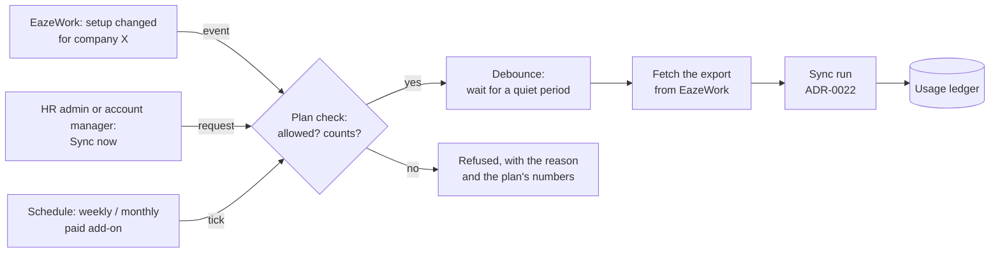
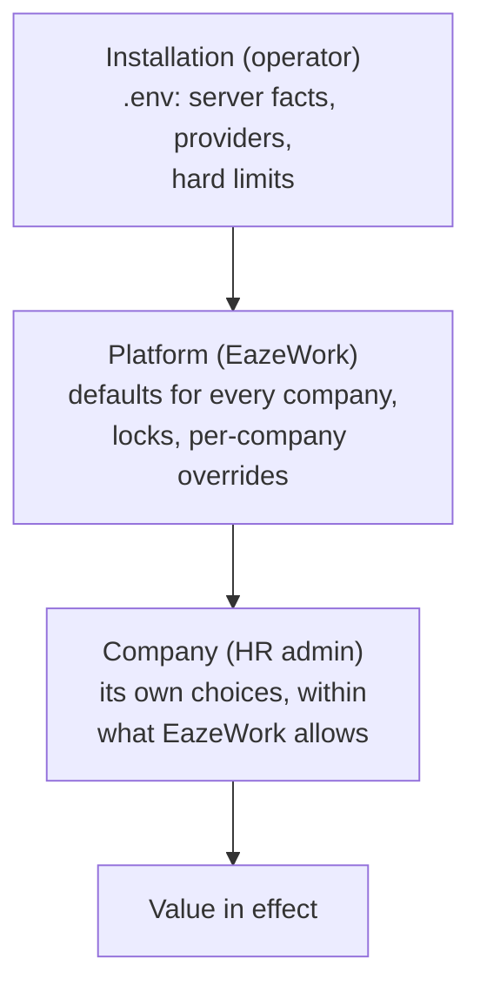

# 09. Roles, sync plans and settings

v0.1 · 2026-10-15 · Status of each decision: see ADR-0024, ADR-0025, ADR-0026 (all Proposed)

EazeWork's answer to the versioning email, and the questions it raises:

- Syncs are **event-driven** (EazeWork tells us a company's setup changed) with a **"Sync now"**
  button. Companies may later buy a **weekly or monthly schedule**. Some number of syncs a month
  is free (e.g. 4); beyond that is paid.
- Three kinds of people use the system: a **module owner** at EazeWork, **HR admins** (several)
  at each client company, and **employees**.
- Settings such as backups and restore policy are set **first by EazeWork for a client, then by
  the client** within what EazeWork allows.

This doc proposes how each works, shows what is already in place, and lists what EazeWork still
has to decide. Where a decision is still open, the design makes it a setting so that the answer is
a value, not a rebuild.

---

## 1. Who is who

### 1.1 Organisations

| Organisation | In CCE today | Example |
|---|---|---|
| **Operator** | whoever runs the server; holds the operator token | us, or EazeWork's ops team if they host it |
| **Platform** | the `platform` tenant (ADR-0015) | EazeWork |
| **Client company** | a `client` tenant | Widget, Acme Pvt Ltd |

### 1.2 Roles

Revised 2026-10-15 after review: module owner and platform admin are one role; account managers
added; support and HR reviewer dropped (either can be added later from existing permissions).

| Role | Belongs to | Does |
|---|---|---|
| **Operator** | the server | Runs the installation: model providers, server backups, upgrades. Not a product role |
| **EazeWork admin** | EazeWork | Creates client companies and sets their plans; approves help-center releases and owns the shared knowledge; sets defaults and limits for companies; assigns account managers; manages EazeWork staff |
| **Account manager** | EazeWork, assigned to specific companies | Works *inside* each assigned company at HR admin level, because clients already ask their account manager to check things and answer questions. Everything they do is recorded as "EazeWork: name" and is visible to the company's HR |
| **HR admin** | client company, several per company | Answers Questions for HR, corrects answers, approves or rolls back syncs, presses Sync now, changes the company's settings within its plan, manages the company's HR admins, decides what EazeWork may see |
| **Employee** | client company | Asks questions, sees answers with sources, flags a wrong answer |

The permissions stay separate inside CCE (approve help-center releases, set plans, manage staff,
…), so if EazeWork later wants a Payroll owner who can't change plans, that is a new role made of
existing permissions, not new code.

### 1.3 What each role can do

| Action | EazeWork admin | Account manager (assigned companies) | HR admin | Employee |
|---|:-:|:-:|:-:|:-:|
| Ask a question | ✓ | ✓ | ✓ | ✓ |
| Flag "this answer is wrong" | | | ✓ | ✓ |
| Answer Questions for HR, correct answers | platform tenant | ✓ | ✓ | |
| Approve a held sync, roll one back, restore to date | platform tenant | ✓ | ✓ | |
| Press Sync now (counts against the plan) | ✓ | ✓ | ✓ | |
| Company settings | sets defaults and limits | within limits | within limits | |
| Approve a help-center release | ✓ | | | |
| Set a company's plan | ✓ | | sees it | |
| Assign account managers | ✓ | | sees who | |
| Add / remove the company's HR admins | first one only | ✗ | ✓ | |
| Decide what EazeWork may see (1.4) | | ✗ | ✓ | |
| Read the employee question log | only with a grant | only with a grant | ✓ | own questions |
| Usage figures | all companies | assigned companies | own company | |
| Server backups, model providers | operator only | | | |

The account manager's access is HR admin level **minus** three things that would let EazeWork
change its own access: managing the company's HR admins, deciding what EazeWork may see, and
reading the employee question log without a grant.

### 1.4 What EazeWork can see, and the time-limited grant

What CCE holds for a company, by sensitivity:

| Data | Where it lives | EazeWork (admin and assigned account managers) |
|---|---|---|
| Configuration and employee profiles | **EazeWork**, not CCE (profiles are never stored, ADR-0018) | n/a |
| Rules derived from the configuration | CCE | ✓ by default (EazeWork has the configuration anyway) |
| HR's answers, Questions for HR, sync history, settings | CCE | ✓ by default (needed to help the client) |
| Rule corrections once HR turns them into knowledge | CCE (Clarifications) | ✓: HR chose to make that wording a rule |
| Unanswered employee questions in Questions for HR | CCE (knowledge gaps) | ✓ the question text, so they can help answer it; not the answer record behind it |
| **What individual employees asked**, the answers they got, corrections that quote them, and "HR details are wrong" flags | CCE (decision traces, corrections) | **Only with a grant.** Without one, "HR details are wrong" items show no question or employee code |

The time-limited grant:
- An HR admin turns on "Let EazeWork see employee questions" and picks a length (default 7 days).
- That creates a grant: company, what it covers (the employee question log), who granted it, when
  it ends. Permission checks consult active grants; it ends by itself and can be revoked at any
  time.
- Every time EazeWork opens the log under a grant, it is recorded in the company's activity log.
- A company can also switch off account manager access entirely (a company setting), for clients
  that don't want EazeWork acting inside their HR knowledge.

### 1.5 How people sign in

CCE should not run its own passwords. EazeWork already knows every HR admin and employee, and
employees already ask through EazeWork's backend (integrator key, ADR-0015). Proposal:

- **EazeWork is the identity provider.** For each request, EazeWork's backend tells CCE who is
  asking, their company and their role, in a short-lived token signed with a key CCE trusts. CCE
  checks the signature and the role, then records the person on everything they do.
- For EazeWork staff and HR admins opening CCE pages directly: single sign-on through EazeWork
  (OpenID Connect) if EazeWork supports it; otherwise the pages are embedded in EazeWork and use
  the same signed token.
- Until then (demo, pilots): **named personal keys** with a role, replacing today's one shared
  admin key per company, so the audit trail says who did what.

### 1.6 What exists today

| Need | Today | Gap |
|---|---|---|
| Company isolation | RLS in the database (ADR-0010) | none |
| EazeWork acting for employees | integrator key + `X-CCE-Tenant` (ADR-0015) | the employee's identity isn't verified, only passed |
| Roles | **Built 2026-10-15** (ADR-0024): EazeWork admin, account manager, HR admin, employee; personal keys; assignments; grants | sign-in through EazeWork |
| Who did it | **Built**: every change records the person; `GET /activity` | none |

---

## 2. Syncs: triggers, plans and metering

### 2.1 Three triggers, one pipeline

Everything after the plan check is the sync run that already exists (ADR-0022): fingerprint, no
change if identical, hold if unusual, otherwise apply, with questions for HR.

- **Event.** EazeWork calls `POST /sync/events` with the company and what changed. HR often
  changes several settings in a row, so events are **debounced**: the sync starts after a quiet
  period (default 15 minutes) and one sync covers all of them.
- **Sync now.** A button for HR admins and EazeWork staff. It runs at once, skipping the quiet
  period.
- **Schedule.** Weekly or monthly at a set day and time, if the company's plan includes it.
- **Fetching the export.** Today an operator copies the `.xlsx` widgets into a folder. Event and
  button syncs need CCE to **fetch the export from EazeWork** by API. Until EazeWork offers that,
  a "drop folder" fetcher reads the newest export placed for the company.

### 2.2 Plans and what counts

A **plan** belongs to a company and is set by EazeWork's platform admin:

| Field | Example | Notes |
|---|---|---|
| `included_syncs_per_period` | 4 | the free allowance |
| `period` | calendar month | or the company's billing month |
| `counted_triggers` | `manual`, `scheduled` | **EazeWork to decide** (2.3) |
| `count_no_change_runs` | false | **EazeWork to decide** |
| `over_limit` | `ask` | `block` / `ask` (HR confirms the charge) / `allow` (bill later) |
| `schedule` | none / weekly / monthly | the paid add-on |
| `event_rate_limit` | 1 per hour | fair use, so a misbehaving integration can't run hundreds |

The **usage ledger** records every sync run with its trigger, whether it counted, and the period.
CCE **meters**; EazeWork **bills**. CCE gives EazeWork a monthly usage report per company (API
and CSV) and never handles prices or invoices.

### 2.3 What should count: the decision EazeWork has to make

| Option | Counts | Effect |
|---|---|---|
| A. Every sync | events, buttons, schedule | Simple, but a company that edits its setup often pays for keeping answers correct |
| **B. Requested syncs only (recommended)** | Sync now and scheduled; events free within fair use | Correctness after a real change is never charged; extra syncs a company *asks for* are |
| C. Only syncs that changed something | any trigger, no-change runs free | Fair, but a company can't tell in advance whether a sync will be charged |

Recommendation: **B, with no-change runs free**. Events keep answers correct. Charging for them
would make it cheaper to have wrong answers. The button and the schedule are what a company
chooses to buy.

When over the limit with `ask`, the button says, for example, "This is sync 5 of 4 included this
month. It will be added to your bill." and needs a second click.

### 2.4 What exists today

| Need | Today |
|---|---|
| Sync run, hold / apply / rollback | ✓ ADR-0022 |
| Event endpoint, button, schedule | ✗ |
| Debounce, rate limit | ✗ |
| Fetch the export by API | ✗ (manual folder) |
| Plans, ledger, usage report | ✗ |

---

## 3. Settings: who sets what, at which level

### 3.1 Three levels

Each setting is declared once with: its levels, its default, its allowed values, and whether
EazeWork may **lock** it. The value in effect is the company's value if it set one and the setting
isn't locked, else EazeWork's value for that company, else EazeWork's default for all companies,
else the installation default. Every change is versioned and logged (who, when, old and new value),
like knowledge.

### 3.2 The settings, by level

| Setting | Default | EazeWork | Company |
|---|---|---|---|
| **Sync** | | | |
| Event-driven sync on | on | ✓ | ✓ |
| Quiet period before an event sync | 15 min | ✓ | ✓ (within bounds) |
| Schedule (weekly / monthly, day, time) | off | enables (plan) | ✓ chooses, if the plan allows |
| Hold a sync above X% changed / Y removed | 20% / 5 | ✓ | ✓ (stricter only) |
| Approve every sync by hand | off | ✓ | ✓ |
| **HR answers and corrections** | | | |
| When a rule an HR answer depends on changes | pause | ✓ | ✓ |
| Rule corrections need a second HR admin | on | ✓ | ✓ (can't turn off if locked) |
| **Answers** | | | |
| Refuse when coverage confidence is below | 0.35 | ✓ | ✗ |
| Show sources to employees | on | ✓ | ✓ |
| **Data** | | | |
| Keep employee questions and answers for | 12 months | ✓ (max) | ✓ (shorter only) |
| Keep raw exports for | 30 days | ✓ | ✓ (shorter only) |
| Monthly export of the company's data | off | enables | ✓ |
| Account manager access to this company | on | | ✓ can switch off |
| EazeWork may read employee questions | off | | ✓ grants, time-limited |
| **Plan** (EazeWork only) | | | |
| Included syncs, period, what counts, over-limit, add-ons | 4 / month / B / ask | ✓ | sees |

Three env settings that exist today move to this table: `CCE_STALE_INTERPRETATIONS`,
`CCE_SYNC_HOLD_*`, `CCE_CORRECTIONS_REQUIRE_APPROVAL`. Their env values become the installation
defaults, so nothing changes until someone sets a value.

### 3.3 Backups and restore: what can be per company

A database backup (ADR-0007) contains every company at once. Restoring it rolls back every
company. So **server backups belong to the operator only**: whoever runs the server sets the
schedule, the off-site target and the rehearsal. Neither EazeWork staff (unless they are the
operator) nor client HR can restore the database.

What a company actually needs from "backup and restore" can be given per company, because
knowledge is versioned:

| A company wants to… | Per-company feature | Status |
|---|---|---|
| Undo a bad sync | Roll back that sync run | ✓ built (ADR-0022) |
| Go back to how answers were on a date | **Restore to date**: re-activate every rule and HR answer as it was on that date, as one new sync-like run that can itself be undone | new; the versions and valid-time already exist |
| See what changed and when | Sync history and the change log | ✓ data exists, page needed |
| Keep its own copy | **Monthly export** of its rules, HR answers and questions (JSON + the handbook report) to its own storage or for download | new |
| Limit how long data is kept | Retention windows (questions and answers, raw exports) | new; also needed for DPDP |

So the "restoration policy" EazeWork sets first and a company adjusts is mostly the Data rows in
3.2, plus who may use **Restore to date** (HR admin by default; EazeWork can require its own
approval).

---

## 4. Pages

| Who | Page | What's on it |
|---|---|---|
| **EazeWork admin** | Companies | Every client: plan, syncs used this month, last sync and status, open questions, health |
| | Company | Its plan, defaults and locks, assigned account managers, Sync now, whether a grant is active |
| | Help-center releases | Held help-center runs to approve; companies with their own version of a changed article (counts) |
| | Platform settings | Defaults and locks for all companies |
| | Usage report | Syncs per company per period, for billing |
| | People | EazeWork staff, roles, and which companies each account manager has |
| **Account manager** | My companies | The HR admin pages below for each assigned company, marked "acting for <company>" |
| **HR admin** (per company) | Home | Open questions, held syncs, last sync, syncs left this month |
| | Questions for HR | Ambiguities, re-confirmations, removals, unanswered employee questions |
| | Syncs | History, Sync now (with the plan count), schedule, roll back, restore to date |
| | Rules | Browse rules and HR answers, versions, the handbook |
| | Corrections | Answers corrected and why |
| | Settings | The company's settings, within EazeWork's limits |
| | People | HR admins; assigned account managers; account manager access on/off; grants to see employee questions |
| | Activity | Who did what, including everything EazeWork did and every read under a grant |
| **Employee** (inside EazeWork) | Chat | Answer with sources; flag a wrong answer |
| **Operator** (command line) | | Server backups, model providers, upgrades, health |

The demo UI (`/demo`) already has the employee chat and Questions for HR. The first real pages
would be the **HR admin pages** (they carry the governance work), then the **EazeWork console**.
Pages can be built in CCE and embedded in EazeWork, or EazeWork can build them on CCE's API. Every
page uses only the API, so both are possible.

---

## 5. What we can build now, and in what order

None of this waits on EazeWork except fetching exports by API and the final pricing rules, and
those are behind settings.

| Step | What | Waits on |
|---|---|---|
| **1. People and roles** | `principals` (person or service, tenant, role, external id); account-manager assignments; access grants with an end date; personal keys; permission checks per action replacing `role == "admin"`; actor recorded on every decision. Signed-token sign-in from EazeWork as a second path | token format from EazeWork (personal keys work meanwhile) |
| **2. Settings** | settings registry with levels, bounds and locks; `GET/PUT /settings` per level; move the three env knobs; settings history | nothing |
| **3. Sync triggers and plans** | `POST /sync/events` (debounced, rate-limited), `POST /sync/now`, schedules in the worker, plans, usage ledger, usage report; drop-folder fetcher | EazeWork's export API for real event syncs |
| **4. HR admin pages** | Home, Questions, Syncs (with plan count), Rules, Settings, People, Activity | 1–3 |
| **5. Company data controls** | retention jobs, monthly company export, restore to date, employee-question grants | 1, 2 |
| **6. EazeWork console** | Companies, plans, defaults and locks, releases, usage | 1–3 |

## 6. Questions for EazeWork

1. **What counts toward the free syncs?** Our recommendation is option B (2.3): Sync now and scheduled syncs count, change events are free within fair use, and syncs that find nothing new are free.
2. **Over the limit:** block, ask HR to confirm the charge (recommended), or allow and bill later?
3. **Billing period:** calendar month or each company's billing month? Does CCE show prices, or only counts?
4. **Sign-in:** can EazeWork sign requests with a per-user token (who, company, role), and offer single sign-on for HR admins opening CCE pages?
5. **Client data:** do you agree that EazeWork sees only metadata unless a client grants time-limited support access?
6. **Exports by API:** can CCE fetch a company's configuration export (and Policies) by API when an event arrives?
7. **Module owners:** one per module (Leave & Attendance, Payroll, …) or one for everything?
8. **Hosting:** who runs the server in production? That person owns server backups.

---

## 7. Addendum (2026-10-18): EazeWork's answers, and what they change

EazeWork answered the versioning email (answers were in red; summarised here) and sent the first
**Overall Setup Data** workbook for Widget — one sheet per module (Attendance, Leave, Separation,
HRIS, Onboarding), every sheet in the Tab / Sub Tab / Parameter / Sub Parameter / Value layout.
The reader for it ships with this addendum (`cce.connectors.eazework_export`, "Overall Setup
Data"): Widget → 51 objects (29 PolicyRule, 22 ProcessPlaybook), 16 questions for HR.

| Our question | Their answer | What changes in the design |
|---|---|---|
| §1 company sync: one run per export, auto-apply with three exceptions, "what changes for employees" report | Accepted ("will go with this"). Doubt: how feasible is linking a question to a specific rule? | Nothing — citations already carry rule, version and `owner: own \| platform`. **Show it in the first demo**; the doubt is answered by the product, not by email |
| §2 help center: shared, person-approved releases, per-company review items on overrides | Common to all companies; released with product updates, monthly or every two months; mobile-app docs are separate and don't matter | Platform releases are **tied to product releases, not a calendar** (release name = product version). Approver = **Director Operations** — that is the "EazeWork admin" role of §1.2; label it so in the console |
| §3 our-side changes kept separate | OK | Nothing (ADR-0022 re-render rule) |
| Q1 same product version for all? who approves releases? | Same version; **different modules and, within modules, different processes/features activated per company.** Director Operations approves | **New: module/feature scoping of platform knowledge.** A company must retrieve only articles for modules and features it has enabled. The setup export's "Processes" sections (Tour Feature = Yes, WFH = Yes, Policy Management = Y …) are the source of a per-company `enabled_features` scope; help-center articles get a module/feature tag at ingest. Extends ADR-0015 (platform inheritance filtered by scope). Backlog, before any second company |
| Q2 who receives review items | A per-company **Tool Administrator** role; may **forward** items to other licensed users | Tool Administrator = §1.2 "HR admin" (rename in UI and docs). Add one action: *forward a review item / question to another principal of the company* — an assignment on the question, recorded in Activity |
| Q3 / Q8 fingerprint + parsed result kept; raw export deleted after 30 days | OK | As designed (§3.2 "Keep raw exports for 30 days") — implement the retention job |
| Q4 pausing an HR answer when its rule changes; cadence | OK while only HR uses the tool, **if the reason is shown**. When employees use it, a "best answer while paused" is needed | Suspension stays (ADR-0022 route 3). The configuration rule already answers meanwhile — that *is* the best answer; what employees need is wording ("HR is re-confirming this; the current setup says …"). Design when employee access is switched on. Cadence: see Q7 |
| Q5 policies: API or export? versions, dates, audience? | POC: **upload**. Production: an API "robust enough" for Zendesk, Zoho Desk, Freshdesk, ServiceNow — **clients run different help-desk software** | Two kinds of article knowledge, not one: EazeWork's help center (platform tenant, release-approved) and **each client's own policy documents in its own help-desk tool** (client tenant). POC: the documents connector (upload). Production: a **help-desk connector family** that pulls articles by each product's API — connectors on our side, not an API they call. Backlog after the first real company |
| Q6 which of A/B/C employees see during a conflict | "Not clear" | Re-ask with a worked example (below) |
| Q7 push or pull? can HR trigger? dates in export? weekly? | **Syncs are triggered by the Tool Administrator; syncs per period are linked to the subscription plan** | Confirms ADR-0025 (Sync now + plan metering, option B). Still open: push vs. pull of the file, whether the export carries last-modified/effective dates, and whether anything syncs without a human pressing the button. Re-ask (below) |

### 7.1 Profiles: should EazeWork call us, or we call them?

Three ways to know who is asking, all already supported by `CCE_PROFILE_PROVIDER`; use them in this order:

1. **POC (now): from the export.** `profile` provider `file`: the employee-policy mapping in the
   export gives each employee's whitelisted attributes; the Tool Administrator "asks as" an
   employee in the demo. Zero integration on EazeWork's side.
2. **Pilot inside EazeWork's UI: push.** Their backend sends the whitelisted attributes inline
   with `/ask` (`profile: {...}`). They control exactly what is sent; nothing is stored; no new
   endpoint on their side. Right as soon as questions come from their screens.
3. **Employees asking directly: pull.** `provider = http`: CCE calls their consent hook
   (`GET …?company=&employee=` with a consent token) per question. Minimal data, their
   whitelist, their consent record. Needed only when employees, not HR, ask — and that is the
   moment Q4's "best answer while paused" also becomes real.

So: don't ask them to build an API yet. Ask them to *send* the profile with the question when the
pilot moves into their UI, and keep the hook for the employee phase.

### 7.2 To re-ask EazeWork (concretely)

1. **Conflicts (Q6), by example.** Widget's setup says Casual Leave is 10 days; HR answered an
   employee's question in September saying 12 (a Clarification). Today's sync shows 10 again.
   Until HR re-confirms: (A) the tool answers 10 and says HR is re-checking; (B) it answers 12,
   HR's last word; (C) it says it cannot answer until HR confirms. Our proposal is A.
2. **Export mechanics (Q7).** When the Tool Administrator presses Sync now, does EazeWork's
   backend push the Overall Setup Data file to us, or do we fetch it by API? Does the export
   carry a last-modified or effective date per parameter? Is there any automatic sync at all
   (e.g. after a setup change), or only the button?
3. **Modules (Q1).** Can the export (or an API) say which modules and features a company has
   enabled, so help-center answers are limited to what the company actually uses? The
   "Processes" sections already carry most of this — is that the right source?
4. **Tool Administrator.** Confirm: one per company (or several), created by EazeWork on
   onboarding; may forward review items to any licensed user; is the only role that presses
   Sync now and sees usage counts.

### 7.3 Built from the answers (2026-10-19)

What the Tool Administrator can now do without us, at `/demo/manage` with their own key
(`cce.api_sync`, `static/manage.html`; CI: `scripts/check_sync_api.py`):

| From | Built |
|---|---|
| §1, Q7 (syncs triggered by the Tool Administrator; per plan) | **Sync now**: upload the Overall Setup Data workbook or widget files → one sync run; applied on its own when nothing is unusual, held for review otherwise; details, apply, discard, roll back. The month's included syncs are shown; beyond them the plan's `block` / `ask` / `allow` applies (ADR-0025, now Accepted) |
| Q2 (Tool Administrator forwards review items) | **Forward**: `POST /questions/{id}/assign` puts a question with a named person; the inbox shows "With Meera"; recorded in Activity. The question stays visible to every admin — forwarding is a label, not a lock |
| Q3 / Q8 (raw export deleted after 30 days) | The worker prunes upload folders after `CCE_EXPORT_RETENTION_DAYS`; the run keeps the fingerprint, the file names and everything read |
| §1.2 naming | `hr_admin` is shown as **Tool Administrator** everywhere in the console |
| ADR-0024 / 0026 (people, settings) | Console tabs for people and keys (add, replace key, remove), settings (effective value, who set it, edit what the company may), activity (incl. "only what EazeWork did") |

**Sign-in through the gate (same night).** With Cloudflare Access in front of an instance,
every proxied request carries a signed token with the visitor's verified email. `cce.access_sso`
verifies it against the team's public keys (audience = the Access application) and maps the email
to a person; the person acts exactly as with their key — same role, permissions, name on every
change. One identity: `/demo` and `/demo/manage` open with nothing to paste. Two (an EazeWork
admin who is also a company's Tool Administrator): a chooser, carried as `X-CCE-As`. None: "ask
your Tool Administrator". Keys stay for the API, scripts and anyone outside the gate, and win
when both are present. Off unless `CCE_ACCESS_TEAM_DOMAIN` + `CCE_ACCESS_AUD` are set. CI:
`scripts/check_access_sso.py`. This is the first rung of ADR-0024's "EazeWork as identity
provider": the gate is the identity provider for now; when questions come from EazeWork's own
screens, their backend's integrator key plus the asker's profile is the path (§7.1).

Still operator-side, on purpose: creating the company and its first Tool Administrator
(EazeWork does that at onboarding, §1.2), platform releases, plan values. Still open: the
export API (push vs pull, Q7), module scoping (Q1), conflicts wording (Q6).
