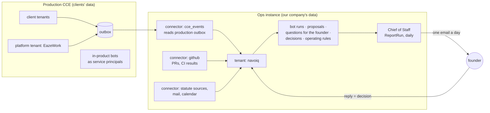

# 10. The bot operating model: running the company on a second CCE

v0.1 · 2026-10-16 · Decisions: ADR-0027 (Ops instance, bots as principals), ADR-0028 (autonomy ladder) — both Proposed

**Question addressed.** CCE will be run by one person for its first six months, then by a few.
Most of the work — keeping answers true as companies change, onboarding companies, watching
statutes, running the servers, reporting to partners, finding customers — should be done by bots.
How are those bots created, managed and deployed? Where do their messages go? When do humans get
added, and for what?

**Short answer.** Run a second CCE instance, the **Ops instance**, whose only tenant is our own
company. Each bot is a principal in it. A bot's job description is a knowledge object; a bot's
unit of work is a run with undo; a founder's ruling on something a bot couldn't decide is a
Clarification pinned to the rule it interprets; the daily brief is a report run. Bots never
message a person directly — they write runs, proposals and questions, and one Reporter bot turns
them into one brief a day. Humans are added per **lane** (role), not per customer, and headcount
scales with domains, jurisdictions and partners, not with companies.

---

## 1. Why the CCE model fits the bot lifecycle

A company of bots needs the same things a company of people needs from an HR and governance
system, and CCE already has them for knowledge:

| Running bots needs… | CCE has… | Where |
|---|---|---|
| A versioned job description per bot, changed by review, never edited in place | Knowledge objects: proposed → certified → superseded | ADR-0013, ADR-0006 |
| A record of every unit of work, held when unusual, undoable as a unit | Sync runs: staged / held / applied / rolled back | ADR-0022 |
| A human's ruling on a case the bot couldn't decide, tied to the rule version it was made under | Clarifications with `interprets` edges pinned to `to_version` | ADR-0022 §5 |
| Rulings that harden into standing rules the bot then applies | Proposal → certify; the compounding thesis itself | doc 00 |
| "What's waiting for me?" | Questions for HR | ADR-0017 |
| A daily brief with numbers from queries and words from a model | ReportTemplate / ReportRun, Reporter archetype | doc 04 §2 |
| Bots as identities with scoped access and an audit trail | Principals, roles, personal keys, time-limited grants | ADR-0024, doc 09 |
| "If I change this rule, which bots are affected?" | Impact preview along dependency edges | doc 01 |
| Bots reacting to each other without coupling | Outbox events, `GET /events?after=` | ADR-0023 |
| Per-bot, per-tenant on/off and limits, with locks and history | Settings registry with three levels | doc 09 §3 |
| Calibrated yes/no at a gate instead of a model's self-report | `decide()` | ADR-0014 |

What does **not** belong in the Ops instance, and must not be forced in:

- **Code.** Git holds bot specs' source and the bots' code. The Ops instance holds the certified
  spec *version* and the build SHA, not the files.
- **Logs and metrics.** Postgres is not a time-series store. The SRE Sentinel writes *events*
  ("restore drill passed", "p95 latency over budget for 30 min"); telemetry stays in the
  deployment's own tooling.
- **Paging.** A plain uptime check pages the operator in seconds. The Ops instance records what
  happened and what was decided; it is not the alarm.

## 2. Topology: production and Ops are two instances of the same image



Three runtimes, chosen by what the bot may touch. The credential separation between them is the
security architecture:

| Runtime | Bots | Credentials | Never holds |
|---|---|---|---|
| **In-product** (production worker, Postgres queue) | Sync Steward, Clarification Chaser, Gap Miner, Correction Triage, Privacy Warden's probes, Partner Support Oracle | A service principal per bot per tenant, RLS-scoped | Repo write access; anything outside its tenant except counts |
| **Repo** (GitHub Actions, Claude Code / Agent SDK) | Eval Guardian, Connector Smith, Release Captain, Scribe | Repo token; an Ops-instance key to record runs | Any production tenant key |
| **Founder-side** (scheduled tasks with mail, calendar, CRM) | Chief of Staff, Pipeline Researcher, Terms Keeper, Usage & Value Reporter's narrative | Ops-instance key; the founder's own connectors | Any production tenant key |

In-product bots ship with the image, so partner-hosted `cce-dist` deployments get them too; the
other two runtimes do not exist for partners, which is correct. The Ops instance reads
production through its outbox exactly as it would read any external corpus — production never
knows the Ops instance exists.

## 3. The four primitives

### 3.1 Bot spec — a knowledge object of type `BotSpec`

Source: a YAML file under `bots/<name>/` in the repo, installed into the Ops instance by the pack
loader like any seed, so a spec change is a proposal that supersedes the previous version.

```yaml
name: sync_steward
archetype: steward            # one of the eight (doc 04 §3 + Operator)
runtime: in_product
triggers: [event: sync.held, event: sync.applied, schedule: daily 02:00]
reads: [sync runs, proposals, question log counts]
writes: [proposals, questions_for_hr, bot_runs]
actions:                      # autonomy is per action type, never per bot
  - id: apply_held_run_params_equal
    reversible: true
    starts_at: L1
    promote_after: 50 consecutive approvals without edit
  - id: suspend_stale_clarification
    reversible: true
    starts_at: L2             # already how production behaves (ADR-0022)
  - id: notify_hr_of_answer_changes
    reversible: false         # an email cannot be unsent
    max_level: L1
budgets:
  human_minutes_per_tenant_month: 10
  tokens_per_tenant_month: 2_000_000
escalates_to: lane:operator
eval_set: evals/bots/sync_steward.yaml   # no eval set, no bot
```

Mandatory fields: what it reads, what it writes, each action type with reversibility and a
starting level, budgets, an escalation lane, and an eval set.

### 3.2 Service principal

ADR-0024 principals already allow "person or service". A bot gets one principal per tenant it
works in, with a role made of existing permissions (an in-product bot in a client tenant has a
subset of HR admin: it may draft, propose and read counts; it may not certify, manage people or
read the employee question log without a grant). Everything it does is recorded against that
principal, so a client's Activity page shows "CCE: sync_steward" the same way it shows
"EazeWork: Priya".

### 3.3 Bot run — a sync run generalized

One row per unit of work: bot, spec version, build SHA, trigger, input fingerprint, outputs
(proposal ids, question ids, events emitted, messages drafted), tokens, duration, outcome,
`decided_by` (`auto:<gate>` or a principal), and status `staged | held | applied | discarded |
rolled_back`. Rolling back a bot run reverts every change it made, like a sync run. The
identical-input rule applies: same fingerprint, same spec version → "no change", no tokens spent.

### 3.4 Decision — a Clarification about the company's own rules

When a run is held, the bot opens a **question for the founder** (the Questions-for-HR machinery,
in the Ops tenant) carrying: what, why now, the options, the bot's recommendation, whether each
option is reversible, the deadline. The founder's reply is stored as a `Clarification` whose
`interprets` edge points at the `BotSpec` action version it was made under, so a later spec change
marks old rulings stale exactly as a config change marks an HR answer stale.

**Decisions compound.** When the Chief of Staff finds N consistent rulings on the same action
type with the same distinguishing feature ("held run, parameters equal → apply"), it proposes an
`OperatingRule`. Certifying it is what moves the action type up a level (§5). This is how a human
leaves the loop: not by writing rules in advance, but by having rulings observed and generalised,
with the human still certifying the generalisation. Later, the same decision log is the first
hire's onboarding material (§7).

## 4. The `ops` domain pack

Deliberately small; STRATEGY §5 forbids a second commercial domain, and this is not one. It is
the minimum that lets the company run itself.

| Knowledge type | Scope | Certified by | Examples |
|---|---|---|---|
| `BotSpec` | tenant | founder (via PR merge + pack install) | §3.1 |
| `OperatingRule` | tenant | founder | "A held sync with equal parameters applies without review"; "No outbound email to a client before 09:00 their time" |
| `Milestone` | tenant | founder | EazeWork: three companies live by 2026-12-15; green card expected 2027-02; exclusivity lapse dates |
| `Lane` | tenant | founder | The six inboxes of §6, each with its owning principal |

One `ReportTemplate`: **the daily brief** (§6.3). One scheduled job: **the weekly bot review**
(§5.3). Entities: bots, lanes, partners, companies (by id only — no client content ever enters
the Ops instance, only counts and ids, per the cross-tenant rule in doc 01 G6).

## 5. Managing bots: the autonomy ladder

Per **action type**, never per bot. A bot may be at L3 for one action and L0 for another.

| Level | Meaning | Human involvement |
|---|---|---|
| **L0** | Observe and produce; output compared with what the human did | Human does the work (shadow mode) |
| **L1** | Propose; a human certifies | Reads and approves each item |
| **L2** | Act behind a calibrated `decide()` gate; undo available; appears in a digest | Reads a summary |
| **L3** | Act; notify only on anomaly | None unless something breaks |

### 5.1 Rules

1. **Only reversible actions may reach L2 or L3.** Irreversible actions (outbound email, billing,
   deletion, a platform release, a statutory interpretation) are capped at L1; the ones that reach
   every company or commit the company to a person need **two** principals.
2. **Probation is shadow mode.** Every new bot, and every new action type, starts at L0 for at
   least two weeks. The human was doing the work anyway, so the cost is nil and the first
   agreement rate is free.
3. **Promotion is earned by a measured record** — the spec's `promote_after` (e.g. 50 consecutive
   approvals without edits), or an `OperatingRule` certified from consistent decisions (§3.4).
   Promotion is itself a settings change, versioned and logged.
4. **Demotion is automatic and immediate**: the first rollback of one of its runs, a client flag,
   a budget breach, or an approval rate collapse drops the action type one level within the hour.
   Levels are re-earned, never re-granted by hand.
5. **Circuit breaker** per bot, per tenant, global: a setting, so the Chief of Staff or an
   operator can send a bot to L0 without a deploy.
6. **Budgets are part of the contract.** Human minutes consumed per tenant-month and tokens per
   tenant-month. A bot that adds to a review queue faster than it removes work is net negative and
   is demoted by rule 4. This is the defence against the certification-fatigue failure in the
   design review (G9), which bots would otherwise make ten times worse.

### 5.2 The one metric

**Human minutes per company per month**, falling. It is computed from decision records (time
from question opened to answered, counted against the lane's owner) plus self-reported edit time.
If it is not falling month over month, bots are not working and hiring would hide that.

### 5.3 The weekly bot review

A ReportRun, Fridays, one page per bot: runs, approvals without edit, edits, rejections,
rollbacks, human minutes consumed, estimated minutes saved, tokens, and a recommendation
(promote / hold / demote / retire) with the evidence. The founder certifies or rejects each
recommendation in an hour. That hour is the entire management overhead of the bot workforce,
and it is the ritual later handed to whoever runs operations.

## 6. Inboxes: lanes, at the trust boundary, collapsed into one brief

Two principles decide where an inbox lives:

- **An inbox belongs to a role, not a person.** A one-person company has one person wearing every
  role, so there is one brief with role-tagged lanes. When someone is hired, a lane becomes their
  inbox with no redesign.
- **An inbox lives where its data lives.** Anything involving a client's knowledge or employees
  stays in production under RLS, visible to that client. The company's own inbox lives in the Ops
  instance, outside client data.

### 6.1 The six lanes

| Lane | Lives in | Owner now | Owner later | What arrives |
|---|---|---|---|---|
| **1. Company HR** | Production, per client tenant (exists) | **The client's HR admin — not us** | same | Ambiguities, re-confirmations, removals, flagged answers; bot-drafted suggestions marked "suggested by CCE" |
| **2. Platform knowledge** | Production, platform tenant | founder | EazeWork admin; a qualified certifier for statutes (§7) | Help-center releases, statutory proposals, impact memos, cross-company counts |
| **3. Operator** | Ops instance | founder | first engineer | Health events, failed jobs, restore-drill result, privacy probe, cost anomalies |
| **4. Engineering** | GitHub, mirrored as runs in Ops | founder | first engineer | PRs, failing evals, held re-renders, connector drafts |
| **5. Customer / partner** | Production console + Ops | founder (plus EazeWork's account managers) | partner manager | Health scores, usage anomalies, renewal risk, support drafts |
| **6. Founder** | Ops only | founder, always | founder, always | Pipeline, terms and milestones, pricing, hiring, anything that commits the company to a person |

**Lane 1 is the most important scaling decision in this document.** The founder is not in it.
Clients govern their own knowledge; bots make that faster. A founder answering a client's
Questions for HR is a product gap to fix, not a task to keep. EazeWork's account managers (doc 09
§1.2) are a human layer in lane 5 that costs us nothing, for the same reason.

### 6.2 Escalation ladder

bot → second-model check (`decide()` with a different model) → the client's HR admin or the
partner's admin → the lane owner → the founder. **Nothing reaches the founder that a bot, a
client or a partner could decide.**

### 6.3 The daily brief

The Chief of Staff is a Reporter: numbers from queries over bot runs, questions and events;
words from a model; gates from `decide()`. Lanes 2–6 collapse into one brief, ranked by
risk × blast radius. Each item carries: what, why now, the bot's recommendation, reversibility,
deadline, and a one-line reply that becomes a decision record (`1 apply`, `3 reject: wording`).
Delivery is distribution v1 from doc 04 — email or Slack. No inbox UI is built until a second
human needs one; lanes 1–2 already have their pages in doc 09 §4.

## 7. Scaling: adding humans per lane, not per customer

The arithmetic that makes a small team possible: **headcount scales with domains × jurisdictions
and with partners, not with companies.** Companies are served by bots and by their own HR.

| Stage | Trigger | Who | Lanes they take | What is deliberately *not* hired |
|---|---|---|---|---|
| **0** — now to ~3 real companies (0–6 months) | — | founder + bots | all, through one brief; target: operations ≤ 1 h/day | anyone |
| **1** — ~10 companies, 2 partners, after seed (~month 6; STRATEGY §7) | a lane exceeds its hour budget for 4 straight weeks *despite* bot improvements, and the work is judgment- or relationship-bound | one engineer; one salesperson | engineer: 3 + 4; sales: the pipeline half of 6 | support or ops staff — bots, client HR and partner account managers cover 1, 2, 5 |
| **2** — ~50 companies, US launch (months 12–18) | statutory layer is the moat and needs a qualified signature | a **knowledge certifier** on retainer (employment-law firm or HR consultant; STRATEGY §5.1 already frames them as certifiers); a partner manager when partners exceed what one person can hold; a second engineer when connectors > 3 | certifier: 2 (statutes); partner manager: 5 | — |
| **3** — second domain, or 200+ companies | a domain earns its place (STRATEGY §5) | one certifier per domain; a small platform team for the primitives | each new domain reuses every bot | — |

**Handover is a data change, not a project.** The new person's principal replaces the founder's
as owner of the lane's queues, and their onboarding reading is the lane's decision log: every held
item, what was chosen and why, and the `OperatingRule`s that came from them — certified objects
with provenance, not a wiki page.

**Never delegated to bots, at any stage:** terms, pricing, hiring, interpretation certification
until a qualified human exists, and any message that commits the company to a person.

## 8. Deploying bots

- A bot spec is **code** and travels change path A (architecture 04): PR → CI runs the bot's eval
  set → merge → image → pack install supersedes the `BotSpec`. A spec change may not be mixed with
  a knowledge change in the same run (the re-render rule, applied to bots).
- Every bot run records `bot_version` and `build_sha`; a bot upgrade triggers a regression run
  over the previous month's inputs, and a changed outcome is held.
- Enablement and autonomy levels are **settings** (doc 09 §3) with platform locks: EazeWork may
  cap a bot at L1 for all its companies; a company may go stricter, never looser; a company may
  switch an in-product bot off for its own tenant.
- The Ops instance is the same image, a separate database, hosted alongside production
  (HOSTING-OPTIONS), with its own backups. Losing it loses the company's memory, not a client's.

## 9. Operating rhythm for the one-person phase

- **Daily, 20 minutes:** the brief. Decide; don't do.
- **Weekly, 1 hour:** the bot review. Promote, hold, demote, retire.
- **Monthly:** restore-drill result, privacy audit, cost per company, the human-minutes trend.
- **Quarterly:** hiring check against the lane signals in §7; retire bots whose lane has gone
  quiet; prune `OperatingRule`s nobody has invoked.

## 10. A week, concretely

- **Mon 07:00.** One email: four items. Item 1, a held sync for a company (23% of rules
  re-scoped after a grade restructure; parameters equal; 2 Clarifications suspended pending that
  company's HR). Reply `1 apply`. A decision record is written against
  `sync_steward.apply_held_run_params_equal` v3. Item 4, Terms Keeper: a milestone is 40 days out
  and one data sign-off is missing.
- **Tue 11:00.** EazeWork posts a setup-changed event; production syncs; a new rule contradicts a
  September HR answer; the answer is suspended and a re-confirmation goes to **that company's HR
  inbox**. The Clarification Chaser sees `question.opened` on the outbox and posts a suggested
  answer there, marked "suggested by CCE". HR accepts it Wednesday. The founder never saw it.
- **Wed.** The Statute Steward diffs a ministry page against certified `StatutoryRule`s, proposes
  a supersession and an impact memo (3 of 3 live companies, interpretations I-4 and I-7
  dependent). Irreversible and platform-wide → L1, two principals → Thursday's brief, item 1.
- **Thu.** A merged PR changed the eligibility prompt; Eval Guardian's per-company regression
  shows one answer changed. It opens a held re-render run. The brief shows the two answers side
  by side: accept or fix? Accept; the new expected answer becomes a test case.
- **Fri 16:00.** Weekly review. `apply_held_run_params_equal` has 50 consecutive approvals without
  edit; the Chief of Staff proposes L1 → L2; the founder certifies; the setting changes with
  history. Gap Miner had a run rolled back on Tuesday and was demoted to L0 within the hour; the
  review only reports it.
- **Month 6.** The first engineer's principal takes lanes 3 and 4. Her first week's reading is
  the decision log for those lanes.

## 11. Build order (design only; nothing here precedes the STRATEGY §6 commitments)

1. **Primitives in the Ops instance:** `BotSpec`, `OperatingRule`, bot runs (a `kind` on
   `source_snapshots` or a sibling table), decisions as Clarifications, the `cce_events`
   connector. The autonomy level as a setting.
2. **Chief of Staff in shadow mode:** the daily brief summarising the founder's *manual* work
   from the outbox, before any bot acts. This is the brief's own probation.
3. **Eval Guardian** (repo runtime; mostly `make eval` and `make baseline` wired to CI with a held
   run on changed answers).
4. **Tenant Onboarder** (contract → first "issues we found" report with no human step).
5. **Sync Steward**, **Clarification Chaser** (in-product), **Usage & Value Reporter** (the
   Day-90 numbers come from here).
6. **Statute Steward** (labour codes; US states before Feb 2027), **Connector Smith** (second
   HRMS source). Pack Architect and Discovery Elicitor wait for a second domain to earn its place.

## 12. Risks

- **Bots flooding review.** Budgets and demotion-on-rollback are the defence; the human-minutes
  metric is the alarm. If the brief exceeds ten items for a week, something is at the wrong level.
- **Automating judgment too early.** The decision log is only as good as the decisions in it.
  Interpretations and anything client-facing stay at L1 longer than feels necessary; a wrong
  answer about pay is the one thing in this business a rollback does not undo.
- **The Ops instance becoming a second product.** The `ops` pack is four types and one report.
  Anything a paying customer would not also need is out of scope.
- **Two instances to run.** Mitigated by one image and the same compose; the Ops database is small
  and its loss is recoverable from git (specs) and the production outbox (events), losing only
  decisions — which is why it has its own backups.

## 13. Open questions

1. Does the Ops instance run as a second tenant in production for the first weeks (one database,
   cheaper) and split when the first partner-hosted deployment appears? The credential argument
   says split from day one; the operations argument says later. Proposed: split from day one, since
   the cost is one more compose file.
2. How is "estimated minutes saved" measured honestly? Proposed: shadow-mode baselines per action
   type, re-measured quarterly, never self-reported by the bot.
3. Which model does the second-model check use? Proposed: the careful tier, with the gate's
   calibration from `make calibrate`.
4. Where does the first hire's principal live before the Ops instance has sign-in — personal key,
   as in doc 09 §1.5?
